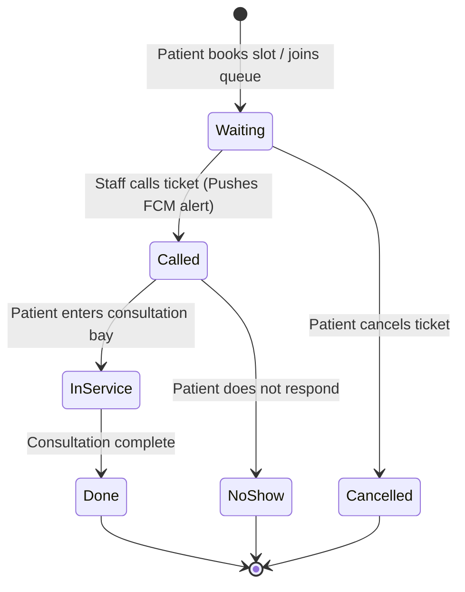

# Clinic Queue (`clinic-queue`) 🏥🇰🇪

[](https://github.com/chris-nairobi/clinic-queue/actions/workflows/ci.yml)
[](LICENSE)
[](https://flutter.dev)
[](https://firebase.google.com)

**Clinic Queue** is a production-grade, portfolio-quality outpatient clinic appointment scheduling and live queue management system built for Kenyan healthcare facilities. Patients book available slots, track their queue position in real time with estimated wait times, receive automated Swahili/English FCM push alerts when they are next, and clinic staff seamlessly manage and advance patient consultation queues.

---

## 📐 System Architecture

### Clean Layering Overview
```mermaid
graph TD
    subgraph "Presentation Layer"
        UI[Flutter UI Widgets & Screens]
        BLoC[AuthBloc / BookingBloc / QueueBloc / StaffBloc]
    end

    subgraph "Domain Layer (Pure Dart)"
        Entities[Clinic / QueueSlot / Ticket / UserProfile]
        UseCases[BookSlot / AdvanceQueue / WatchLiveQueue]
        RepoInterfaces[AuthRepository / QueueRepository / ClinicRepository]
    end

    subgraph "Data Layer"
        RepoImpl[AuthRepositoryImpl / QueueRepositoryImpl]
        DataSources[FirestoreQueueDataSource / FcmRemoteDataSource]
        FirebaseSDK[Firebase Firestore & Auth SDKs]
    end

    UI --> BLoC
    BLoC --> UseCases
    UseCases --> RepoInterfaces
    RepoImpl ..|> RepoInterfaces
    RepoImpl --> DataSources
    DataSources --> FirebaseSDK
```

### Live Queue State Machine


---

## 🚀 Key Features & Kenya Context

- **Kenyan Telephony & Timezone**: Strict `+254` Safaricom/Airtel phone number validation (`+2547XXXXXXXX` or `+2541XXXXXXXX`), localized currency display (**KES**), and `Africa/Nairobi` timezone scheduling.
- **Bilingual Localisation**: Native support for **Swahili (`sw`)** and **English (`en`)** dynamic UI copy and push notification templates (*"You are next! (Foleni wa Kliniki)"*).
- **Live Queue Position & Rolling Wait Time**: Real-time Firestore reactive streams computing exact "people ahead" and estimated wait times based on a rolling average of service duration.
- **Offline Resilience**: Firestore offline persistence enabled with visual `NetworkBanner` state indicating "Offline, showing last known queue".
- **Zero Diagnostic Data Logging**: Only non-diagnostic appointment reason codes (e.g., `TRIAGE_GENERAL`, `PHARMACY_PICKUP`) stored to strictly preserve patient privacy.
- **Role-Guarded Portals**: Separate patient experience and staff management dashboard protected by Firestore Security Rules.

---

## 🛠️ Tech Stack

- **Mobile Framework**: Flutter 3.19+ / Dart 3
- **State Management**: BLoC (`flutter_bloc`, `bloc_test`)
- **Dependency Injection**: `get_it` + `injectable`
- **Routing**: `go_router` with reactive auth & role guards
- **Backend & Cloud Services**: Firebase Auth, Cloud Firestore, Cloud Messaging (FCM)
- **Cloud Infrastructure**: Firebase Cloud Functions (TypeScript)
- **Local Testing Environment**: Firebase Emulator Suite (`auth`, `firestore`, `functions`)
- **Testing**: `flutter_test`, `bloc_test`, `mockito`, `alchemist` (Golden UI tests), `integration_test`
- **Build & CI/CD**: Fastlane + GitHub Actions CI workflow

---

## 💻 Quick Start & Local Development

### Prerequisites
- [Flutter SDK 3.19+](https://docs.flutter.dev/get-started/install)
- [Node.js 18+](https://nodejs.org/)
- [Firebase CLI](https://firebase.google.com/docs/cli) (`npm install -g firebase-tools`)
- Java Development Kit (JDK 17+) for Firebase Emulators

### 1. Repository Setup
```bash
# Clone the repository
git clone https://github.com/chris-nairobi/clinic-queue.git
cd clinic-queue

# Install Flutter & Cloud Functions dependencies
make setup
```

### 2. Start Firebase Emulator Suite
In a separate terminal window, launch the local emulator:
```bash
make emulator
```
*The Firebase Emulator UI will be accessible at [http://127.0.0.1:4000](http://127.0.0.1:4000).*

### 3. Run the Mobile App (Dev Flavor)
```bash
make dev
```

---

## 🧪 Testing Suite

Execute unit, BLoC, and Cloud Functions tests with a single command:

```bash
# Run all mobile unit/BLoC tests and Cloud Functions tests
make test

# Run static analysis and linter
make lint
```

---

## 🗺️ Roadmap & Continuous Improvements

- [x] Clean Architecture foundation with BLoC & Injectable DI
- [x] Firebase Local Emulator integration for Auth, Firestore, and Functions
- [x] Swahili & English localization (`app_en.arb`, `app_sw.arb`)
- [x] Automated FCM queue position push notification triggers
- [ ] Integration with Safaricom M-Pesa Daraja STK Push for private clinic consultation fees
- [ ] SMS fallbacks via Africa's Talking API for non-smartphone patients

---

## 📄 License
This project is licensed under the MIT License - see the [LICENSE](LICENSE) file for details.
